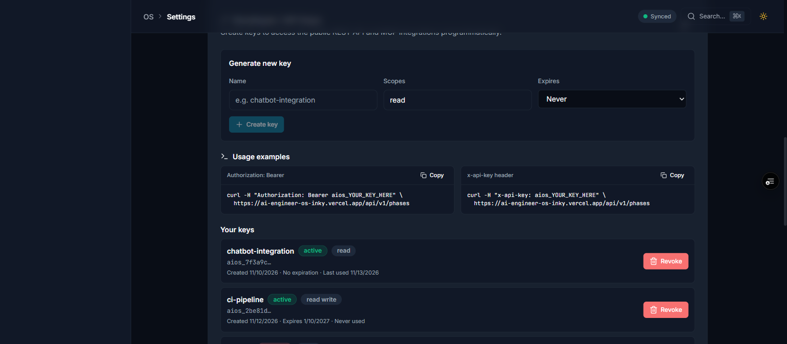

# AI Engineer OS

**A structured, open-source learning platform for building practical AI engineering skills** — curriculum, projects, progress sync, and a public API designed for humans and AI agents alike.

[](LICENSE)
[](https://nextjs.org)
[](https://www.typescriptlang.org)
[](https://postgresql.org)
[](https://github.com/khrish11/AI-ENGINEER/actions)

**Live**: [ai-engineer-os-inky.vercel.app](https://ai-engineer-os-inky.vercel.app)

---

## Overview

AI Engineer OS turns the [AI Engineering from Scratch](https://github.com/rohitg00/ai-engineer-from-scratch) curriculum into an interactive learning workspace: 20 phases, 500+ lessons, project studios, spaced review, and cloud-synced progress — plus a documented REST API and MCP server so chatbots and agents can consume the same curriculum programmatically.

## Features

- **Structured curriculum** — 20 phases from math foundations to autonomous agents, with lessons, quizzes, code files, and notebooks
- **Project studio** — milestone-based builds with rubrics, evidence tracking, and self-assessment
- **Progress & sync** — guest mode with local-first storage (IndexedDB) and authenticated cloud sync via PostgreSQL, with conflict resolution
- **Accounts** — Google and GitHub OAuth (Auth.js), per-user data isolation
- **Public REST API** — `/api/v1/*` for phases, lessons, resources, projects, quiz, analytics, and streaming lesson content
- **API keys** — self-serve key management in Settings (Bearer or `x-api-key`), scopes, expiration, revocation, per-key rate limits
- **Webhooks** — HMAC-signed event delivery with SSRF and DNS-rebinding protections
- **MCP server** — JSON-RPC endpoint (`/api/mcp`) exposing curriculum tools to AI agents
- **Portfolio** — public, shareable learning portfolios with privacy controls

<details>
<summary><b>Screenshot — Developer / API Keys in Settings</b></summary>



</details>

## Architecture

```
Next.js 16 (App Router) · React 19 · TypeScript 5.7 · Tailwind CSS
├── Auth.js (Google / GitHub OAuth, JWT sessions)
├── REST API        /api/v1/*        (API-key or public access)
├── MCP endpoint    /api/mcp         (JSON-RPC tools)
├── Sync API        /api/sync/v1     (session-authenticated)
├── Webhooks        /api/webhooks    (session-authenticated)
└── PostgreSQL 17 + Drizzle ORM      (users, progress, api_keys, webhooks, rate_limits)
```

Migrations live in `src/db/migrations/` and run via `npm run db:migrate` (Drizzle-tracked, advisory-locked). The app never migrates automatically on deploy.

## Getting Started

```bash
git clone https://github.com/khrish11/AI-ENGINEER.git
cd AI-ENGINEER
npm install
cp .env.example .env.local   # fill in values below
npm run dev                  # http://localhost:3000
```

### Environment variables

| Variable | Purpose |
|---|---|
| `DATABASE_URL` | PostgreSQL connection string (required) |
| `AUTH_SECRET` | Auth.js session secret |
| `AUTH_GOOGLE_ID` / `AUTH_GOOGLE_SECRET` | Google OAuth |
| `AUTH_GITHUB_ID` / `AUTH_GITHUB_SECRET` | GitHub OAuth (optional) |
| `NEXT_PUBLIC_APP_URL` | Canonical app URL |

Apply the schema once against your database:

```bash
npm run db:migrate
```

## Authentication & API keys

1. Sign in with Google or GitHub on **Settings → Account**.
2. Open **Settings → Developer / API Keys**, name a key, pick scopes and optional expiry.
3. The secret is shown **once** — store it securely.

Authenticate API requests with either header:

```bash
curl -H "Authorization: Bearer aios_YOUR_KEY" \
  https://ai-engineer-os-inky.vercel.app/api/v1/phases

curl -H "x-api-key: aios_YOUR_KEY" \
  https://ai-engineer-os-inky.vercel.app/api/v1/phases
```

Invalid, expired, or revoked keys return `401`. Requests without credentials get public read access only; account-scoped endpoints (`/api/user/*`, `/api/webhooks`, `/api/admin/*`, `/api/sync/*`) always require a session.

## REST API & MCP

Base URL: `https://ai-engineer-os-inky.vercel.app`

| Endpoint | Description |
|---|---|
| `GET /api/v1/phases` | List all phases |
| `GET /api/v1/phases/{slug}` | Phase detail with lessons |
| `GET /api/v1/lessons` | Search lessons (`?q=`, `?phase=`) |
| `GET /api/v1/lessons/{phase}/{lesson}` | Full lesson content |
| `GET /api/v1/quiz/{phase}/{lesson}` | Stored quiz questions |
| `GET /api/v1/resources` | Curated resources |
| `GET /api/v1/projects` | Project catalog |
| `GET /api/v1/analytics` | Curriculum statistics |
| `GET /api/v1/stream/{phase}/{lesson}` | SSE lesson stream |
| `POST /api/mcp` | MCP JSON-RPC (`tools/list`, `tools/call`) |

Full reference: [docs/API_DOCUMENTATION.md](docs/API_DOCUMENTATION.md)

MCP example:

```bash
curl -X POST https://ai-engineer-os-inky.vercel.app/api/mcp \
  -H "Content-Type: application/json" \
  -d '{"jsonrpc":"2.0","id":1,"method":"tools/list"}'
```

## Development commands

```bash
npm run dev          # dev server
npm run build        # production build
npm run typecheck    # tsc --noEmit
npm run lint         # ESLint
npm run test         # Vitest unit + integration suite
npm run test:e2e     # Playwright E2E
npm run validate     # full local validation
npm run db:migrate   # apply pending Drizzle migrations
npm run mcp:validate # MCP manifest/registry drift check
```

Integration tests need a PostgreSQL database; set `DATABASE_URL` in `.env.test` (see `.env.example`).

## Project structure

```
src/
  app/            Next.js routes (pages + API)
  components/     UI components (settings, curriculum, roadmap…)
  db/             Drizzle schema, client, migrations, migrate runner
  lib/            auth, curriculum service, progress sync, webhooks, MCP
  test/           Vitest suites (unit + PostgreSQL integration)
  mcp/            MCP tool registry
docs/             architecture, API, migration, and ops documentation
config/           drizzle/playwright configuration
scripts/          migration and audit helpers
```

## Documentation

- [API reference](docs/API_DOCUMENTATION.md)
- [Architecture](docs/ARCHITECTURE.md)
- [Database design](docs/DATABASE_DESIGN.md)
- [Progress sync](docs/PROGRESS_SYNC.md)
- [MCP guide](docs/MCP_GUIDE.md)
- [Deployment](docs/DEPLOYMENT.md)
- [Testing](docs/TESTING.md)

## Deployment

Deployed on Vercel with automatic production deploys from `main`. The build does **not** run migrations — apply `npm run db:migrate` manually against the target database.

## Contributing

See [docs/CONTRIBUTOR_GUIDE.md](docs/CONTRIBUTOR_GUIDE.md). Please run `npm run validate` before opening a PR.

## License

MIT — see [LICENSE](LICENSE). Curriculum content derives from [AI Engineering from Scratch](https://github.com/rohitg00/ai-engineering-from-scratch) (MIT, © Rohit Ghumare).
