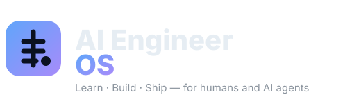
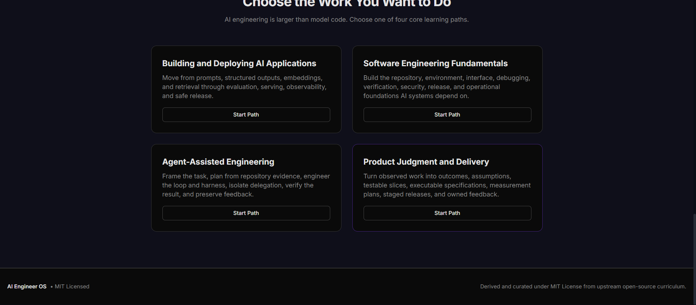
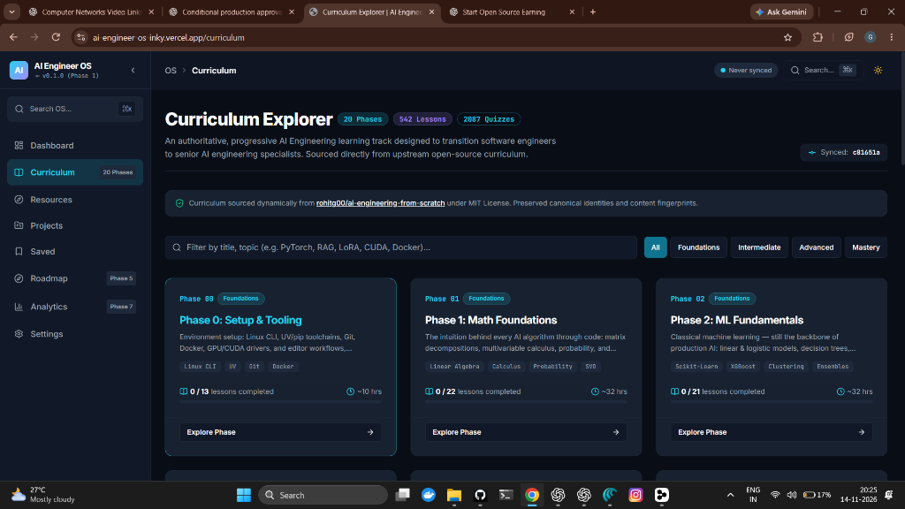
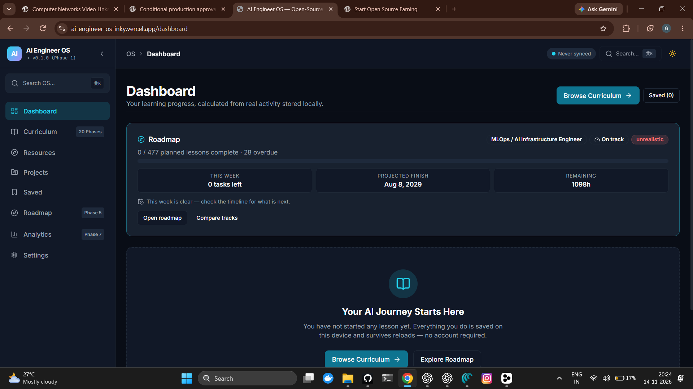
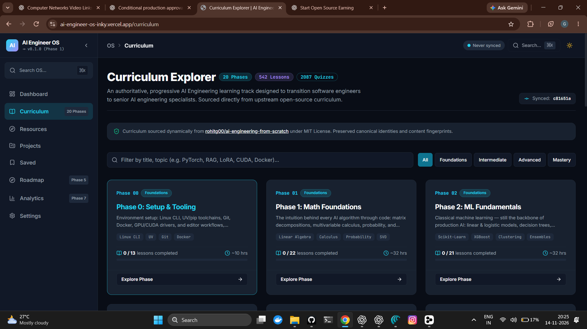
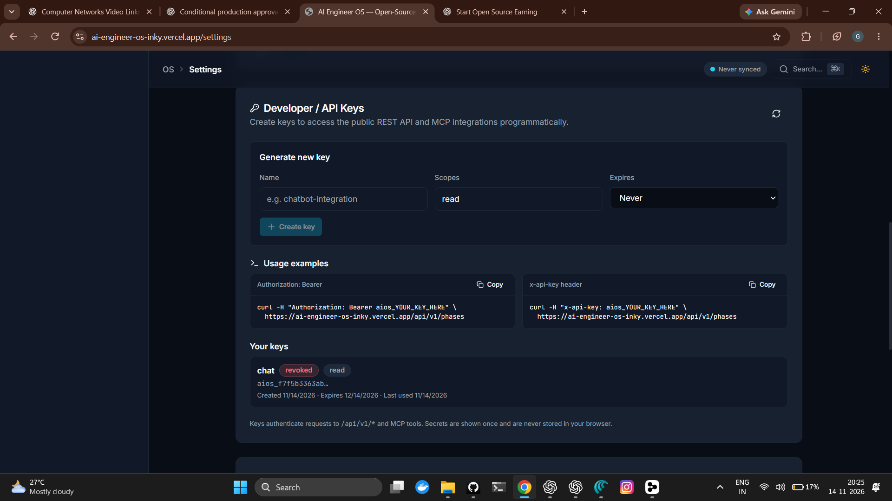
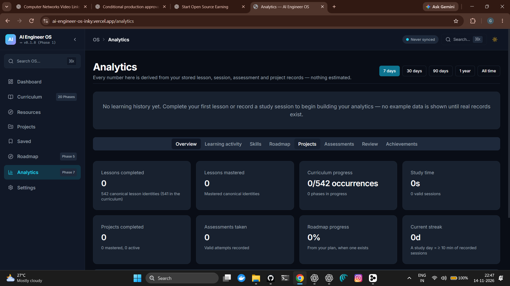

<div align="center">

<p align="center"></p>

**A structured, open-source learning platform for building practical AI engineering skills** — curriculum, projects, synced progress, and a public API built for humans and AI agents alike.

<p align="center">
  <a href="https://ai-engineer-os-inky.vercel.app"></a>&nbsp;
  <a href="LICENSE"></a>&nbsp;
  <a href="https://github.com/khrish11/AI-ENGINEER/actions/workflows/pr-validation.yml"></a>&nbsp;
  <a href="https://github.com/khrish11/AI-ENGINEER/pulls"></a>
</p>

<p align="center">
  <a href="#-key-features">Features</a> ·
  <a href="#-product-tour">Tour</a> ·
  <a href="#-architecture">Architecture</a> ·
  <a href="#-get-started">Get Started</a> ·
  <a href="#-rest-api--api-keys">API</a> ·
  <a href="#-mcp-integration">MCP</a> ·
  <a href="#-documentation">Docs</a>
</p>

</div>

---

AI Engineer OS turns the [AI Engineering from Scratch](https://github.com/rohitg00/ai-engineering-from-scratch) curriculum into a production-grade learning workspace: **20 phases, 542 lessons**, project studios with rubric-based assessment, local-first progress with cloud sync, and a documented REST + MCP surface so chatbots and coding agents can consume the same curriculum programmatically.

<div align="center">

</div>

## ✦ Key Features

<details open>
<summary><b>📚 Structured curriculum & lessons</b></summary>

- 20 progressive phases from linear algebra and Python tooling to LLMs, agents, RAG, and autonomous swarms
- 542 canonical lessons, each with reading content, quizzes backed by stored correct answers, and downloadable code files/notebooks
- Phase and lesson detail views with resource curation (YouTube, GitHub, official docs)
- Search across lessons by keyword and phase
</details>

<details>
<summary><b>🛠 Project studio & assessment</b></summary>

- Milestone-based project builds with rubrics, evidence tracking, and self-assessment
- Portfolio profiles with shareable public pages and privacy controls
- Review history and spaced-repetition surfacing of weak areas
</details>

<details>
<summary><b>🔄 Progress, sync & accounts</b></summary>

- Guest mode with local-first storage (IndexedDB via Dexie) — learn before signing up
- Google & GitHub OAuth via Auth.js; cloud sync to PostgreSQL with deterministic conflict resolution
- Cross-device restore: sign in on a second device and pick up exactly where you left off
- Account isolation guaranteed — one account never sees another's progress
</details>

<details>
<summary><b>🔑 Developer API & API keys</b></summary>

- Public REST API (`/api/v1/*`) for phases, lessons, quiz, resources, projects, analytics, and SSE lesson streaming
- Self-serve API keys in **Settings → Developer**: named keys, scopes, expiration, one-time secret display, revocation
- `Authorization: Bearer` and `x-api-key` both supported; per-key rate limits (1000 req/hr) vs anonymous IP limits (60 req/min)
- Invalid, expired, or revoked keys return `401`; only explicitly public routes allow anonymous access
</details>

<details>
<summary><b>🪝 Webhooks</b></summary>

- Register endpoints for curriculum/progress events; HMAC-SHA256 signed payloads
- SSRF protections: URL validation at registration, private-IP blocking, DNS-rebinding checks
- Owner-scoped management — users can only touch their own webhooks
</details>

<details>
<summary><b>🤖 MCP server for AI agents</b></summary>

- JSON-RPC 2.0 endpoint at `/api/mcp` (`tools/list`, `tools/call`)
- Tools for curriculum lookup, lesson content, quizzes, projects, analytics, and learning recommendations
- Manifest-driven registry kept in sync by CI validation
</details>

## 🖥 Product Tour

<div align="center">

</div>

*Dashboard — roadmap progress, overdue tasks, projected finish, and activity-based streak tracking.*

<div align="center">

</div>

*Curriculum Explorer — 20 phases, 542 lessons, progress indicators, and phase-level navigation.*

<div align="center">

</div>

*Project Studio — milestone-based builds with rubrics, evidence tracking, and difficulty-level filtering.*

<div align="center">

</div>

*Roadmap — personalized phase ordering, capacity planning, deadline tracking, and backlog management.*

<div align="center">

</div>

*Analytics — time-on-task, completion rates, per-phase mastery, streaks, and skill bands derived from real activity.*

<div align="center">

</div>

*Lesson view — reading pane, embedded code, quiz block, notes, bookmarks, and study timer.*

## 🏗 Architecture

```mermaid
graph TB
    subgraph Client["Next.js 16 · React 19 · TypeScript 5.7"]
        A[App Router]
        B[Auth.js - Google/GitHub OAuth]
        C[Dexie/IndexedDB - Local Progress]
    end

    subgraph API["REST + MCP APIs"]
        D[/api/v1/* - Public API]
        E[/api/sync/v1 - Cloud Sync]
        F[/api/mcp - MCP Server]
        G[/api/webhooks - Event Hooks]
        H[/api/user/api-keys - Key Mgmt]
    end

    subgraph DB["PostgreSQL 17 · Drizzle ORM"]
        I[users]
        J[progress tables]
        K[api_keys]
        L[webhooks]
        M[rate_limits]
    end

    A --> B
    A --> C
    A --> D
    A --> E
    B --> I
    C --> J
    E --> J
    F --> J
    G --> J
    H --> K
    D --> J
    D --> M
    E --> K
    G --> L
```

- **Local-first**: all learning state lives in IndexedDB; mutations queue and flush to `/api/sync/v1`
- **API auth**: SHA-256-hashed keys (secrets never stored), atomic PostgreSQL rate-limit upserts
- **Migrations**: Drizzle-tracked SQL in `src/db/migrations/`, applied manually via `npm run db:migrate` — deploys never migrate

## 🚀 Get Started

```bash
git clone https://github.com/khrish11/AI-ENGINEER.git
cd AI-ENGINEER
npm install
cp .env.example .env.local
npm run db:migrate   # apply schema to your DATABASE_URL
npm run dev          # http://localhost:3000
```

### Environment

| Variable | Purpose |
|---|---|
| `DATABASE_URL` | PostgreSQL connection string (required) |
| `AUTH_SECRET` | Auth.js session secret |
| `AUTH_GOOGLE_ID` / `AUTH_GOOGLE_SECRET` | Google OAuth |
| `AUTH_GITHUB_ID` / `AUTH_GITHUB_SECRET` | GitHub OAuth (optional) |
| `NEXT_PUBLIC_APP_URL` | Canonical app URL |

## 🔑 REST API & API Keys

1. Sign in (Google/GitHub) → **Settings → Developer / API Keys**
2. Create a key — the secret is shown **once**
3. Call the API:

```bash
curl -H "Authorization: Bearer aios_YOUR_KEY" \
  https://ai-engineer-os-inky.vercel.app/api/v1/phases

# or
curl -H "x-api-key: aios_YOUR_KEY" \
  https://ai-engineer-os-inky.vercel.app/api/v1/phases
```

| Endpoint | Description |
|---|---|
| `GET /api/v1/phases` `/{slug}` | Phase catalog & detail |
| `GET /api/v1/lessons` `/{phase}/{lesson}` | Lesson search & full content |
| `GET /api/v1/quiz/{phase}/{lesson}` | Stored quiz questions |
| `GET /api/v1/resources` `/api/v1/projects` | Curation & project catalog |
| `GET /api/v1/analytics` | Curriculum statistics |
| `GET /api/v1/stream/{phase}/{lesson}` | SSE lesson stream |

Full reference: [docs/API_DOCUMENTATION.md](docs/API_DOCUMENTATION.md)

## 🤖 MCP Integration

```bash
curl -X POST https://ai-engineer-os-inky.vercel.app/api/mcp \
  -H "Content-Type: application/json" \
  -d '{"jsonrpc":"2.0","id":1,"method":"tools/list"}'
```

Tools cover curriculum search, lesson content, quizzes, projects, analytics, and recommendations. Registry/manifest drift is enforced by `npm run mcp:validate` in CI. See [docs/MCP_GUIDE.md](docs/MCP_GUIDE.md).

## 🧪 Development

```bash
npm run dev          # dev server
npm run build        # production build
npm run typecheck    # tsc --noEmit
npm run lint         # ESLint
npm run test         # Vitest (unit + PostgreSQL integration)
npm run test:e2e     # Playwright
npm run validate     # full local gate
npm run db:migrate   # apply migrations
```

Integration tests run against a disposable `ai_engineer_os_test` database (see `.env.example`).

## 📁 Project Structure

```
src/
  app/          pages + API routes
  components/   UI (settings, curriculum, roadmap, studio…)
  db/           Drizzle schema, client, migrations
  lib/          auth, curriculum, sync, webhooks, MCP
  test/         Vitest suites
docs/           architecture, API, ops docs
config/         drizzle & playwright config
```

## 📜 Releases

<details>
<summary><b>Recent merged work</b></summary>

- **API security & auth platform** — PostgreSQL-backed API keys, webhooks, atomic rate limiting, Bearer + `x-api-key` support, SSRF/DNS-rebinding protections
- **Settings → API Keys** — self-serve key management UI with one-time secrets and curl examples
- **Sync correctness** — cloud-pull timestamps, conflict handling, account isolation
- **Migration runner hardening** — journal/SQL verification, advisory locks, schema checks
- **Analytics crash fix** — RoadmapStore parsing validation, graceful degradation for malformed roadmap state
</details>

## 📚 Documentation

[API](docs/API_DOCUMENTATION.md) · [Architecture](docs/ARCHITECTURE.md) · [Database](docs/DATABASE_DESIGN.md) · [Sync](docs/PROGRESS_SYNC.md) · [MCP](docs/MCP_GUIDE.md) · [Deployment](docs/DEPLOYMENT.md) · [Testing](docs/TESTING.md) · [Contributing](docs/CONTRIBUTOR_GUIDE.md)

## License

MIT — curriculum derives from [AI Engineering from Scratch](https://github.com/rohitg00/ai-engineering-from-scratch) (MIT, © Rohit Ghumare).
