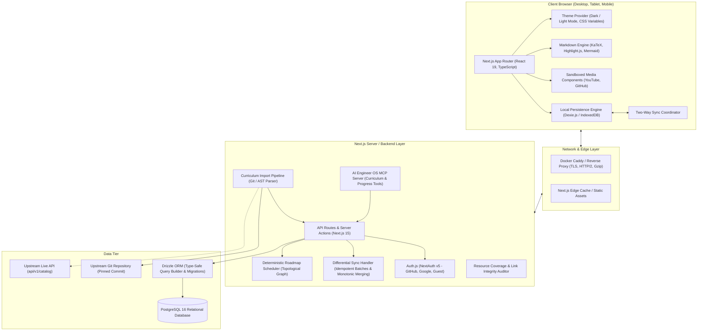
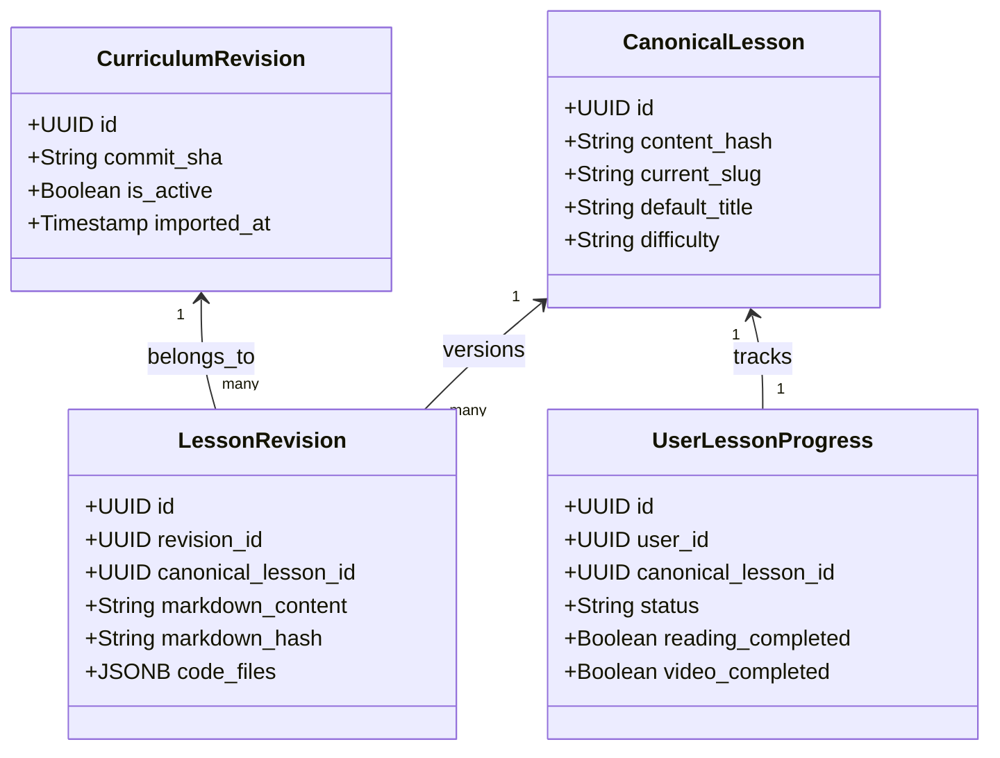

# Architecture Document
## AI Engineer OS — Architectural Blueprint & Technical Decisions (Corrected)

---

### 1. Architectural Philosophy & Principles

AI Engineer OS is built around five core architectural pillars:
1. **Decoupled Identity & Revisions**: Canonical lesson identities exist independently from transient Git commit snapshots. Updating the upstream curriculum revisions never cascades, breaks, or orphans user progress.
2. **Deterministic, Idempotent Synchronization**: Offline-first learning via Dexie.js (IndexedDB) synchronizes to PostgreSQL using discrete immutable study sessions, revision-aware note merges, monotonic status state machines, and client-generated batch idempotency keys.
3. **Realistic Phased MVP Delivery**: A focused learner-facing MVP (Phases 1–4) prioritizes curriculum navigation, rich lesson reading with original attribution, verified resource discovery, project catalog links, and robust local/account progress tracking before layering advanced automated grading or dynamic schedulers.
4. **Sandboxed Security**: Learner coding exercises and project submissions never execute arbitrary code on the application server. Third-party media (YouTube) renders exclusively in sandboxed iframes.
5. **Synergy with Upstream Tooling**: Pinned Git revisions provide deterministic, offline-capable content, while upstream live APIs and Model Context Protocol (MCP) servers are utilized for version checking and AI coding agent tool integration.

---

### 2. High-Level System Architecture



---

### 3. Separation of Canonical Identity from Version Revisions



- `canonical_lessons.id` (UUID) is the **sole genuine immutable identity**. Never changes, never depends on upstream paths or titles. All user progress, notes, bookmarks, and learning plan items reference this UUID.
- `canonical_lessons.content_hash` (SHA-256) is a **fingerprint for change detection and possible identity matching**, never the identity itself. It enables detection of renamed/moved lessons and assists in ambiguous mapping decisions, but the UUID remains the authoritative identity.
- When an upstream update occurs, a new `curriculum_revisions` record is created with its corresponding `lesson_revisions`.
- `user_lesson_progress`, `notes`, `bookmarks`, and `learning_plan_items` bind strictly to `canonical_lessons(id)`.
- **Upstream Changes Handling**:
  - **Renamed/Moved**: `content_hash` matches → retain `id`, update `current_slug`, add old path to `lesson_aliases`. No progress disruption.
  - **Split/Merged**: `content_hash` not found → create new records, flag originals as deprecated. Requires manual review for progress mapping.
  - **Removed**: Lesson marked deprecated, never deleted. User progress preserved for historical record.
  - **Ambiguous Mapping**: Heuristic match logged as `requires_manual_review`. Maintainer must explicitly decide progress transfer strategy.
- Re-importing or updating curriculum never touches or deletes user progress.

---

### 4. Redesigned Offline Synchronization Protocol

To eliminate study time duplication, lost notes, accidental status regressions, and non-idempotent retries, synchronization follows strict operational rules:

```mermaid
sequenceDiagram
    autonumber
    actor Learner as Learner (Guest / Account)
    participant Client as Client Browser (Dexie.js)
    participant Sync as Sync Coordinator
    participant API as Server API (/api/sync)
    participant DB as PostgreSQL Database

    Learner->>Client: Study session completes (e.g. 15 mins)
    Client->>Client: Insert study_session { client_session_id: UUID, duration: 900 }
    Learner->>Client: Update note text
    Client->>Client: Increment note.revision & record base_revision

    Sync->>Client: Collect dirty records & assign client_batch_id (UUID)
    Sync->>API: POST /api/sync { client_batch_id, study_sessions, notes, progress }
    
    API->>DB: Check sync_batches for client_batch_id
    alt Batch Already Processed (Retry)
        API-->>Sync: Return cached idempotent success response
    else New Batch
        rect rgb(240, 248, 255)
            Note over API,DB: 1. Study Sessions: INSERT ... ON CONFLICT (user_id, client_session_id) DO NOTHING
            Note over API,DB: 2. Status: Monotonic Rank max(client_rank, server_rank). No status regression!
            Note over API,DB: 3. Notes: If server_revision > client_base_revision -> Record conflict; merge non-destructively
            Note over API,DB: 4. Record client_batch_id in sync_batches
        end
        API->>DB: Commit transaction
        API-->>Sync: Return server delta, conflict flags, and acknowledged batch ID
        Sync->>Client: Clear dirty flags & mark synced
    end
```

#### Monotonic Status Ranks
Status cannot be demoted by an older client:
1. `not_started` (Rank 0)
2. `in_progress` (Rank 1)
3. `completed` (Rank 2)
4. `mastered` (Rank 3)
*Note: `needs_review` is represented as an independent boolean review flag (`needs_review: true`), not a status regression.*

---

### 5. Upstream Curriculum API & MCP Strategy

The upstream repository exposes both static files and dynamic endpoints:
- `api/v1/catalog.js`: Published catalog JSON endpoint.
- `api/mcp.js`: Model Context Protocol server exposing curriculum inspection tools.

#### Architectural Decision:
1. **Primary Source-of-Truth**: The **Pinned Git Revision** (`c81651a83aff5f7bf307ffe4392f0d97f3b27ad6`) is the sole immutable foundation for curriculum ingestion. This guarantees complete offline availability, deterministic builds, and cryptographic verification without external uptime dependencies.
2. **Upstream Live API Usage**: The updater CLI (`npm run upstream:check-updates`) optionally probes `https://aiengineeringfromscratch.com/api/v1/catalog` to detect new upstream versions or lesson additions before running a Git pull.
3. **AI Engineer OS MCP Server Adapter**: In Phase 8, AI Engineer OS implements an internal Model Context Protocol server (`src/mcp/`) allowing AI coding agents (Claude Desktop, Cursor, Antigravity) to query local curriculum lessons, search topics, and inspect the learner's active roadmap tasks.

---

### 6. Realistic Phased MVP Definition

To avoid over-engineering before core learner value is delivered, features are strictly phased:

- **Core MVP (Phases 1–4)**:
  1. Full 20-phase curriculum navigation and responsive sitemap.
  2. Rich lesson reading workspace with syntax-highlighted code, Mermaid diagrams, and clean upstream MIT attribution.
  3. Curated resource drawer (verified YouTube embeds, GitHub cards, official documentation).
  4. Basic project catalog with difficulty tiers, milestone checklists, and GitHub submission links (read-only reference).
  5. Local progress tracking (Guest Mode via IndexedDB) and versioned JSON backup/restore.
- **Enhanced Platform (Phases 5–7)**:
  - Phase 5: Deterministic prerequisite-aware roadmap scheduler.
  - Phase 6: Interactive pre/post quiz engine, enhanced Project Studio with detailed rubrics and proof-of-work submission forms.
  - Phase 7: Real-time study analytics and shareable public portfolio.
- **Ecosystem & Hardening (Phases 8–9)**:
  - Phase 8: Community PR resource contribution workflow and local MCP server.
  - Phase 9: End-to-end test suite (Playwright), Docker self-hosting, and security verification.

---

### 7. Phase 4 As-Built: Local-First Progress Layer

The protocol above was implemented as follows (see [`PROGRESS_SYNC.md`](PROGRESS_SYNC.md) for the full reference).

**Client boundary**

```
Pages / components
      │  (hooks only)
      ▼
useLessonProgress · useResourceProgress · useNotes · useBookmarks
useStudySession · useQuizAttempts · useProjectProgress · useSyncStatus
useOfflineStatus · useLearnerStats · useProgressOverview · useConflicts
      ▼
Repositories (src/lib/progress/repositories/*)
      ▼
Dexie database (aiEngineerOsDb, schema v3)   ──► syncQueue
      ▼
Sync coordinator (src/lib/progress/sync/client.ts)
      ▼
POST /api/sync/v1  ──►  Auth.js session ──►  PostgreSQL
```

**Server merge state is hydrated from PostgreSQL.** `hydrateStore()` builds the
sync engine's in-memory view from `user_lesson_progress`, `notes`, `bookmarks`,
`study_sessions`, `quiz_attempts`, `project_progress` and `tombstones` before
each batch. `processSyncBatch()` stays a pure function and is unit-tested;
`persistMutations()` writes the accepted mutations transactionally per entity.

**Idempotency** is enforced twice: `sync_batches.response_json` replays prior
responses, and immutable tables rely on unique keys
(`(user_id, client_session_id)`, `(user_id, attempt_id)`).

**Change pull.** `GET /api/sync/v1` returns a full snapshot for guest→account
merge. `POST` responses include `remoteChanges` for rows updated in
`(lastSyncCursor, batchStart]`; applying them marks records `synced` without
re-queueing, preventing echo loops.

**Status monotonicity is applied at three layers:** the completion engine, the
repository upsert path, and the server merge. Any one of them can prevent a
stale write from downgrading a learner.

**Cursor choice.** Cursor values are ISO-8601 server timestamps. This keeps
the protocol simple and instance-independent, at the cost of clock precision
ties; a future version can replace the cursor with a monotonic sequence number
without changing the request shape.

---

### 8. Phase 5 As-Built: Roadmap Engine Layer

The deterministic roadmap is a **client-side, pure-function engine layered on
top of the Phase 4 progress store** — no new server state and no LLM:

```
roadmaps/ (JSON configuration, imported at build time)
  tracks/*.json            7 career tracks: coreSkills, targetRoles, per-lesson importance
  metadata/*.json          occurrence metadata: prerequisites, difficulty, estimatedMinutes
  skills/taxonomy.json     skill groups + skills referenced by skillTags
      ▼
src/lib/roadmap/
  graph.ts        prerequisite DAG: topo sort, cycle detection, reachability
  scheduler.ts    week-by-week planner (pure, deterministic, fixed capacity)
  rescheduler.ts  rebuilds only work from today forward; history immutable
  capacity.ts     comfortable / achievable / tight / unrealistic analysis
  placement.ts    optional deterministic placement from quiz + self-assessment
  store.ts · progress.ts      Dexie-backed roadmap state + completion resolution
      ▼
hooks (useRoadmap, useRoadmapSettings, useCurrentWeek, …)
      ▼
/onboarding · /roadmap · /roadmap/paths (+ /api/roadmap/placement)
```

**Identity rules.** Scheduling and prerequisites operate on curriculum
occurrences (542 parsed locations); completion is resolved through canonical
lesson identities (541). The two Vision-Transformer occurrences both remain in
the graph and share one canonical progress key, so completing one satisfies
both in the schedule without either disappearing.

**Determinism.** `generateRoadmap()` is a pure function of its inputs (track,
hours/week, dates, study days, buffers, completion sets, manual in/excludes);
unit tests assert identical inputs yield identical plans. The full design
reference is [`ROADMAP_ENGINE.md`](ROADMAP_ENGINE.md).

---

## Phase 6 - Project Studio & Assessment Engine

Phase 6 is strictly additive to the sync architecture: two new entity types ride
the existing local-first pipeline without protocol changes.

- **Catalog definitions are static imports.** `projects/catalog/<phase>/*.json`
  and `assessments/catalog/*.json` are Zod-validated at module load
  (`src/lib/projects/catalog.ts`, `src/lib/assessments/catalog.ts`), so a broken
  definition fails the build rather than rendering. Learner status persists in
  storage, never inside the definitions.
- **New Dexie stores (version 4):** `projectEvidence` (immutable entries with
  soft deletes) and `projectSelfAssessments` (one row per project with
  per-category scores). Both are members of `LEARNING_TABLES`, so export/import
  clearing and merge transactions cover them automatically.
- **Sync protocol additions:** `project_evidence` and `project_self_assessment`
  entity types are validated in `protocol.ts`, persisted server-side in
  `/api/sync/v1` (PostgreSQL tables from migration `0005`), echoed through
  `remoteChanges`, and applied locally by the sync client. Merge semantics are
  upward-only: milestone completion is monotonic, self-assessment keeps the
  learner's best score per rubric category, and remote evidence copies never
  smother pending local edits.
- **Pure computing core:** project status and skill mastery are computed by
  pure, unit-tested functions (`computeProjectStatus`, `scoreRubric`,
  `computeMasteryEvidence`, `weakSkillIds`) over persisted inputs - no scoring
  logic lives inside React components.
- **Execution boundary:** no learner project code is ever executed by the
  platform (no repo clone/run, no submissions shell, no uploaded code runners).
  Future isolated evaluation must go through the documented `ProjectEvaluator`
  interface with a safe implementation only.

### Phase 7 — analytics & portfolio layer

- **Source-of-truth rule.** Every analytics metric is derived live from stored
  learner records (lesson progress, study sessions, quiz attempts, project
  progress/evidence, roadmap state, review history). No duplicated counters.
- **Pure analytics core.** `src/lib/analytics/*` modules are deterministic,
  I/O-free functions consumed via memoized hooks (`useAnalytics`); components
  never calculate metrics inline.
- **Timezone handling.** Timestamps are stored UTC; day-bucketing and streaks
  use one explicit learner timezone via memoized `Intl.DateTimeFormat`.
- **Portfolio publication.** `portfolio_profiles` stores only publication
  CONFIGURATION; the public view re-reads live learner data through a strict
  allow-list serializer (`public-view.ts`), making deletion-propagation and
  privacy defaults structural, not behavioural.
