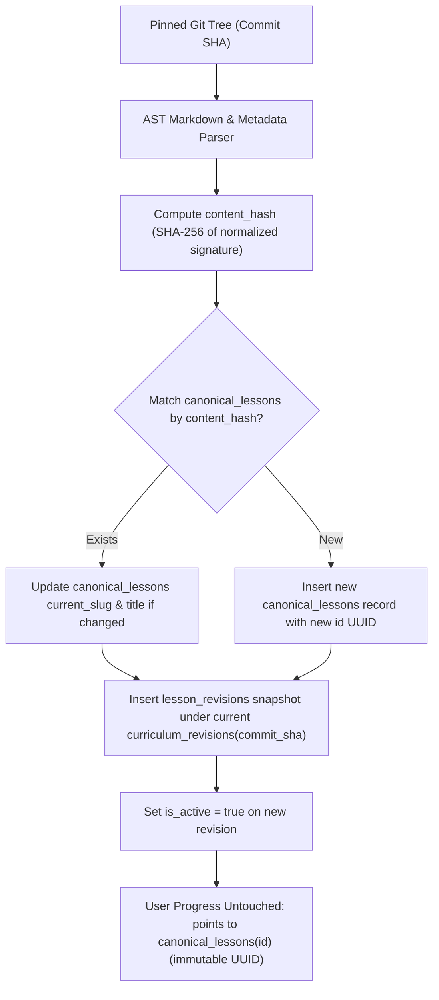

# Curriculum Ingestion & Synchronization Specification
## AI Engineer OS — Upstream Curriculum Integration (Corrected)

---

### 1. Foundation & Attribution

AI Engineer OS uses the open-source curriculum published in:
- **Upstream Repository**: [`rohitg00/ai-engineering-from-scratch`](https://github.com/rohitg00/ai-engineering-from-scratch)
- **Primary Website**: [`https://aiengineeringfromscratch.com/`](https://aiengineeringfromscratch.com/)
- **Upstream License**: MIT License (Copyright (c) 2026 Rohit Ghumare)
- **Pinned Commit Revision**: `c81651a83aff5f7bf307ffe4392f0d97f3b27ad6`

#### Attribution Policy
Every lesson rendered within AI Engineer OS prominently displays:
1. Original phase title, number, and lesson name.
2. Direct link to the source file on GitHub at the pinned commit.
3. Original author attribution and upstream MIT license badge.
4. Clear visual separation between upstream original curriculum content and independently curated resources / platform projects.

---

### 2. Dual-Layer Curriculum Ingestion Strategy

To support reproducible, offline-first deployments while enabling painless future upstream additions, AI Engineer OS employs a two-tier strategy:

```
Primary Source of Truth: Pinned Git Revision (c81651a)
├── Full offline availability
├── Deterministic AST parsing (docs/en.md, quiz.json, code/)
└── Cryptographic integrity via Git tree & commit SHAs

Secondary Live Check: Upstream API (/api/v1/catalog)
├── Optional network check for metadata diffs & version releases
└── Validates upstream phase/lesson counts without full repository downloads
```

---

### 3. Separation of Canonical Lessons from Revision Snapshots

When upstream releases updates, existing learner progress must **NEVER** be orphaned or broken.



#### Ingestion Rules:
1. **Content Hash Generation**: Each lesson generates a `content_hash` (SHA-256) from a normalized signature combining title, learning objectives, and key topic headings. This provides a stable internal identity **independent of upstream filenames, folder paths, titles, or ordering**.
2. **Canonical Mapping**: If the `content_hash` exists in `canonical_lessons`, the existing `id` UUID is retained (genuinely immutable). If an upstream lesson is renamed or moved, update `current_slug` and add the old path to `lesson_aliases`. **User progress remains bound to the immutable `id` UUID.**
3. **Revision Snapshotting**: The parsed markdown content, content hash (`markdown_hash`), code file manifest, and outputs are saved to `lesson_revisions` tied to the specific `curriculum_revisions` record.
4. **Upstream Change Handling**:
   - **Renamed or Moved Lesson (Same Content)**: `content_hash` matches → retain `id`, update `current_slug`, add old path to `lesson_aliases`. No progress disruption.
   - **Split Lesson (One → Many)**: `content_hash` not found → create new `canonical_lessons` records, mark original as deprecated. **Requires manual review** for progress mapping decision.
   - **Merged Lessons (Many → One)**: `content_hash` not found → create new `canonical_lessons` record, mark originals as deprecated. **Requires manual review** for progress mapping decision.
   - **Removed Lesson**: Mark as deprecated, never delete. User progress preserved for historical record.
   - **Ambiguous Mapping**: When heuristics suggest similarity but `content_hash` does not match, log as `mapping_status = 'requires_manual_review'`. Maintainer must explicitly decide whether to map to existing lesson (update content), create new lesson, or deprecate old and create new. **No automatic progress transfer without explicit maintainer decision.**
5. **Zero Progress Disruption**: `user_lesson_progress`, `study_sessions`, `notes`, and `bookmarks` reference `canonical_lessons(id)` (immutable UUID). No user records are deleted or modified during an import.

---

### 4. Upstream Published API & MCP Tools Integration

#### Upstream Catalog API (`/api/v1/catalog`)
- The upstream project exposes `/api/v1/catalog` returning the JSON catalog structure generated by `build_catalog.py`.
- AI Engineer OS CLI includes `npm run upstream:check-updates` which calls this endpoint to inspect upstream changes, new phases, or lesson additions before running a new Git import.

#### Model Context Protocol (MCP) Integration
- Upstream provides an MCP server (`api/mcp.js`) exposing tools for LLMs.
- AI Engineer OS **will provide** a compatible internal MCP server adapter (`src/mcp/`) in Phase 8 that enables AI assistants (Claude, Cursor, Antigravity) to query:
  - `search_curriculum`: search canonical lessons by keyword, phase, or difficulty.
  - `get_lesson_content`: fetch Markdown content and code implementations for a given lesson slug.
  - `get_learner_status`: inspect active learning plan items and study time for pair-programming assistance.

---

### 5. Ingestion Verification & Idempotency Rules

Every curriculum import execution must satisfy the following checks:
1. **Idempotency**: Running `npm run curriculum:import -- --sha c81651a83aff5f7bf307ffe4392f0d97f3b27ad6` twice produces identical database state with 0 duplicate records.
2. **Dynamic Lesson Counts**: Lesson counts are determined dynamically by querying the database (`SELECT COUNT(*) FROM canonical_lessons`). No hardcoded expectations (e.g. 500 or 542) are asserted.
3. **All 20 Phases Verified**: Confirms that all 20 phases (Phase 00 to Phase 19) are ingested with valid ordering and titles.
