# Database Design & Relational Schema
## AI Engineer OS — PostgreSQL & Drizzle ORM Specification (Corrected)

---

### 1. Entity-Relationship Overview

The database design strictly separates **permanent canonical identities** (lessons, phases, prerequisites) from **version-specific content revisions** (markdown content snapshots, code file lists, AST metadata) and **user-owned learning progress**.

```mermaid
erDiagram
    curriculum_sources ||--o{ curriculum_revisions : publishes
    canonical_phases ||--o{ canonical_lessons : contains
    canonical_phases ||--o{ phase_revisions : snapshots
    canonical_lessons ||--o{ lesson_revisions : snapshots
    curriculum_revisions ||--o{ phase_revisions : groups
    curriculum_revisions ||--o{ lesson_revisions : groups
    
    canonical_lessons ||--o{ lesson_aliases : maps
    canonical_lessons ||--o{ lesson_prerequisites : requires
    canonical_lessons ||--o{ lesson_resources : links
    resources ||--o{ lesson_resources : attached_to
    resources ||--o{ resource_contributions : proposed_via
    canonical_lessons ||--o{ quizzes : assesses
    quizzes ||--o{ quiz_attempts : records
    projects ||--o{ project_lessons : covers
    canonical_lessons ||--o{ project_lessons : practiced_in
    
    users ||--o{ accounts : authenticates
    users ||--o{ sessions : authorizes
    users ||--o{ user_lesson_progress : tracks
    users ||--o{ user_resource_progress : tracks
    users ||--o{ study_sessions : logs
    users ||--o{ sync_batches : processes
    users ||--o{ learning_plans : creates
    learning_plans ||--o{ learning_plan_items : schedules
    users ||--o{ notes : writes
    users ||--o{ bookmarks : saves
    users ||--o{ quiz_attempts : submits
    users ||--o{ project_submissions : delivers
    users ||--o{ resource_contributions : submits

    canonical_lessons ||--o{ user_lesson_progress : tracked_by
    canonical_lessons ||--o{ study_sessions : studied_in
    resources ||--o{ user_resource_progress : tracked_by
    canonical_lessons ||--o{ notes : annotated_in
    canonical_lessons ||--o{ bookmarks : bookmarked_in
    projects ||--o{ project_submissions : submitted_for
```



---

### 2. Core Relational Entities

#### 2.1 Curriculum Identity & Version Management

##### `curriculum_sources`
Registers upstream curriculum repositories.
```sql
CREATE TABLE curriculum_sources (
    id UUID PRIMARY KEY DEFAULT gen_random_uuid(),
    name VARCHAR(100) NOT NULL,
    repository_url VARCHAR(255) NOT NULL UNIQUE,
    default_branch VARCHAR(50) NOT NULL DEFAULT 'main',
    license_spdx VARCHAR(50) NOT NULL DEFAULT 'MIT',
    author_attribution TEXT NOT NULL,
    created_at TIMESTAMPTZ NOT NULL DEFAULT NOW(),
    updated_at TIMESTAMPTZ NOT NULL DEFAULT NOW()
);
```

##### `curriculum_revisions`
Tracks imported Git commit SHAs, import timestamps, and version activation.
```sql
CREATE TABLE curriculum_revisions (
    id UUID PRIMARY KEY DEFAULT gen_random_uuid(),
    source_id UUID NOT NULL REFERENCES curriculum_sources(id) ON DELETE RESTRICT,
    commit_sha VARCHAR(40) NOT NULL,
    version_tag VARCHAR(50),
    is_active BOOLEAN NOT NULL DEFAULT FALSE,
    phase_count INTEGER NOT NULL DEFAULT 0,
    lesson_count INTEGER NOT NULL DEFAULT 0,
    imported_at TIMESTAMPTZ NOT NULL DEFAULT NOW(),
    import_duration_ms INTEGER,
    raw_totals JSONB NOT NULL DEFAULT '{}'::jsonb,
    CONSTRAINT uq_source_commit UNIQUE (source_id, commit_sha)
);
CREATE INDEX idx_curriculum_revisions_active ON curriculum_revisions(is_active);
```

##### `canonical_phases`
Permanent identity for the 20 curriculum phases. Does NOT depend on any specific Git commit.
```sql
CREATE TABLE canonical_phases (
    id UUID PRIMARY KEY DEFAULT gen_random_uuid(),
    phase_number INTEGER NOT NULL UNIQUE,
    permanent_key VARCHAR(100) NOT NULL UNIQUE, -- e.g. "phase-00-setup-and-tooling"
    default_slug VARCHAR(100) NOT NULL,
    default_title VARCHAR(150) NOT NULL,
    created_at TIMESTAMPTZ NOT NULL DEFAULT NOW(),
    updated_at TIMESTAMPTZ NOT NULL DEFAULT NOW()
);
CREATE INDEX idx_canonical_phases_order ON canonical_phases(phase_number);
```

##### `phase_revisions`
Version-specific snapshot of phase titles, descriptions, and ordering for a specific commit SHA.
```sql
CREATE TABLE phase_revisions (
    id UUID PRIMARY KEY DEFAULT gen_random_uuid(),
    revision_id UUID NOT NULL REFERENCES curriculum_revisions(id) ON DELETE CASCADE,
    canonical_phase_id UUID NOT NULL REFERENCES canonical_phases(id) ON DELETE CASCADE,
    slug VARCHAR(100) NOT NULL,
    title VARCHAR(150) NOT NULL,
    description TEXT,
    order_index INTEGER NOT NULL,
    CONSTRAINT uq_revision_phase UNIQUE (revision_id, canonical_phase_id)
);
CREATE INDEX idx_phase_revisions_lookup ON phase_revisions(revision_id, canonical_phase_id);
```

##### `canonical_lessons`
Permanent logical identity for lessons. All user progress, notes, bookmarks, and project mappings reference this table via the immutable `id` UUID. It NEVER cascades or gets deleted during curriculum updates.

**Critical Identity Policy**: The `id` UUID is the **sole genuine immutable identity**. It is generated once upon first import and never changes, regardless of upstream renames, moves, title changes, or structural reorganization. All user progress, notes, bookmarks, and learning plan items reference this UUID. The `content_hash` (SHA-256) is a **fingerprint for change detection and possible identity matching**, never the identity itself. It enables detection of renamed/moved lessons and assists in ambiguous mapping decisions.

```sql
CREATE TABLE canonical_lessons (
    id UUID PRIMARY KEY DEFAULT gen_random_uuid(),
    canonical_phase_id UUID NOT NULL REFERENCES canonical_phases(id) ON DELETE RESTRICT,
    content_hash VARCHAR(64) NOT NULL UNIQUE, -- SHA-256 hash of normalized content signature (title + objectives + key sections) for stable identity independent of upstream paths
    current_slug VARCHAR(120) NOT NULL,        -- e.g. "00-setup-and-tooling/01-dev-environment" (mutable, tracks upstream structure)
    default_title VARCHAR(200) NOT NULL,      -- mutable, tracks upstream title changes
    tagline TEXT,
    difficulty VARCHAR(20) NOT NULL DEFAULT 'Beginner', -- Beginner | Intermediate | Advanced
    estimated_minutes INTEGER NOT NULL DEFAULT 45,
    created_at TIMESTAMPTZ NOT NULL DEFAULT NOW(),
    updated_at TIMESTAMPTZ NOT NULL DEFAULT NOW()
);
CREATE INDEX idx_canonical_lessons_phase ON canonical_lessons(canonical_phase_id);
CREATE INDEX idx_canonical_lessons_slug ON canonical_lessons(current_slug);
CREATE INDEX idx_canonical_lessons_content_hash ON canonical_lessons(content_hash);
```

**Identity Lifecycle & Mapping Strategy**:

1. **Initial Import**: Generate `content_hash` from normalized lesson signature (title, learning objectives, key topic headings). Generate `id` UUID. Store both in `canonical_lessons`.

2. **Renamed Lesson (Same Content)**: Upstream changes `phase-00/lesson-01-dev-environment` → `phase-00/lesson-01-environment-setup`. The `content_hash` matches, so existing `canonical_lessons(id)` is retained. Update `current_slug`. Add old slug to `lesson_aliases`. **User progress unaffected.**

3. **Moved Lesson (Same Content)**: Upstream moves lesson from Phase 00 to Phase 01. The `content_hash` matches, so existing `canonical_lessons(id)` is retained. Update `canonical_phase_id` and `current_slug`. Add old full path to `lesson_aliases`. **User progress unaffected.**

4. **Split Lesson (One → Many)**: Upstream splits "Deep Learning Fundamentals" into "Backpropagation" and "Optimization". Original `content_hash` not found. Create new `canonical_lessons` records for each new lesson. Mark original as `is_deprecated = true` (optional extension table or flag). **User progress mapping requires manual review** - flagged in admin dashboard.

5. **Merged Lessons (Many → One)**: Upstream merges two short lessons into one comprehensive lesson. Original `content_hash` values not found. Create new `canonical_lessons` record. Mark originals as deprecated. **User progress mapping requires manual review** - flagged in admin dashboard.

6. **Removed Lesson**: Upstream deletes a lesson entirely. Existing `canonical_lessons(id)` remains (never deleted). Mark as `is_deprecated = true`. Lesson remains in user progress history but removed from active curriculum navigation. **User progress preserved for historical record.**

7. **Ambiguous Mapping (Multiple Candidates)**: When `content_hash` does not match any existing record but heuristics suggest similarity (fuzzy title match, shared objectives), importer logs as `mapping_status = 'requires_manual_review'`. Maintainer must decide whether to: (a) map to existing lesson (update content), (b) create new lesson, or (c) deprecate old and create new. **No automatic progress transfer without explicit maintainer decision.**

##### `lesson_revisions`
Snapshot of lesson content for a specific Git revision. Holds the raw Markdown, content hash, code file list, and outputs.
```sql
CREATE TABLE lesson_revisions (
    id UUID PRIMARY KEY DEFAULT gen_random_uuid(),
    revision_id UUID NOT NULL REFERENCES curriculum_revisions(id) ON DELETE CASCADE,
    canonical_lesson_id UUID NOT NULL REFERENCES canonical_lessons(id) ON DELETE CASCADE,
    title VARCHAR(200) NOT NULL,
    markdown_content TEXT NOT NULL,
    markdown_hash VARCHAR(64) NOT NULL,
    lesson_type VARCHAR(20) NOT NULL DEFAULT 'Build', -- Build | Learn
    languages TEXT[] NOT NULL DEFAULT '{}',
    learning_objectives TEXT[] NOT NULL DEFAULT '{}',
    has_code BOOLEAN NOT NULL DEFAULT FALSE,
    has_quiz BOOLEAN NOT NULL DEFAULT FALSE,
    has_notebook BOOLEAN NOT NULL DEFAULT FALSE,
    code_files JSONB NOT NULL DEFAULT '[]'::jsonb,
    outputs JSONB NOT NULL DEFAULT '[]'::jsonb,
    created_at TIMESTAMPTZ NOT NULL DEFAULT NOW(),
    CONSTRAINT uq_revision_lesson UNIQUE (revision_id, canonical_lesson_id)
);
CREATE INDEX idx_lesson_revisions_lookup ON lesson_revisions(revision_id, canonical_lesson_id);
```

##### `lesson_aliases`
Maps historical, renamed, or relocated slugs to their canonical lesson identity.
```sql
CREATE TABLE lesson_aliases (
    id UUID PRIMARY KEY DEFAULT gen_random_uuid(),
    canonical_lesson_id UUID NOT NULL REFERENCES canonical_lessons(id) ON DELETE CASCADE,
    alias_slug VARCHAR(150) NOT NULL UNIQUE,
    created_at TIMESTAMPTZ NOT NULL DEFAULT NOW()
);
CREATE INDEX idx_lesson_aliases_slug ON lesson_aliases(alias_slug);
```

##### `lesson_prerequisites`
Directed acyclic graph dependencies between canonical lessons.
```sql
CREATE TABLE lesson_prerequisites (
    canonical_lesson_id UUID NOT NULL REFERENCES canonical_lessons(id) ON DELETE CASCADE,
    prerequisite_lesson_id UUID NOT NULL REFERENCES canonical_lessons(id) ON DELETE RESTRICT,
    is_hard_prerequisite BOOLEAN NOT NULL DEFAULT TRUE,
    PRIMARY KEY (canonical_lesson_id, prerequisite_lesson_id)
);
```

---

#### 2.2 Resource Registry & Editorial Approval

##### `resources`
Curated multimedia, repositories, documentation, and exercises.
```sql
CREATE TABLE resources (
    id UUID PRIMARY KEY DEFAULT gen_random_uuid(),
    canonical_url TEXT NOT NULL UNIQUE,
    title VARCHAR(255) NOT NULL,
    description TEXT,
    resource_type VARCHAR(30) NOT NULL, 
    -- 'youtube_video' | 'youtube_playlist' | 'github_repo' | 'official_doc' | 
    -- 'written_tutorial' | 'research_paper' | 'dataset' | 'interactive_exercise' | 'project_starter'
    author_name VARCHAR(150) NOT NULL,
    author_url TEXT,
    difficulty VARCHAR(20) NOT NULL DEFAULT 'All Levels',
    language VARCHAR(10) NOT NULL DEFAULT 'en',
    duration_minutes INTEGER,
    license VARCHAR(50),
    editorial_review_status VARCHAR(20) NOT NULL DEFAULT 'pending_review', 
    -- 'verified' | 'pending_review' | 'rejected' | 'deprecated'
    editorial_reviewed_by UUID REFERENCES users(id),
    editorial_reviewed_at TIMESTAMPTZ,
    last_verified_at TIMESTAMPTZ NOT NULL DEFAULT NOW(),
    created_at TIMESTAMPTZ NOT NULL DEFAULT NOW(),
    updated_at TIMESTAMPTZ NOT NULL DEFAULT NOW()
);
CREATE INDEX idx_resources_type ON resources(resource_type);
CREATE INDEX idx_resources_review_status ON resources(editorial_review_status);
```

##### `lesson_resources`
Many-to-many junction connecting canonical lessons to curated resources without record duplication.
```sql
CREATE TABLE lesson_resources (
    canonical_lesson_id UUID NOT NULL REFERENCES canonical_lessons(id) ON DELETE CASCADE,
    resource_id UUID NOT NULL REFERENCES resources(id) ON DELETE CASCADE,
    is_primary BOOLEAN NOT NULL DEFAULT FALSE,
    order_index INTEGER NOT NULL DEFAULT 0,
    curator_notes TEXT,
    PRIMARY KEY (canonical_lesson_id, resource_id)
);
CREATE INDEX idx_lesson_resources_lesson ON lesson_resources(canonical_lesson_id);
```

##### `resource_contributions`
Submissions from community contributors requiring editorial approval.
```sql
CREATE TABLE resource_contributions (
    id UUID PRIMARY KEY DEFAULT gen_random_uuid(),
    submitted_by UUID REFERENCES users(id) ON DELETE SET NULL,
    canonical_lesson_id UUID NOT NULL REFERENCES canonical_lessons(id) ON DELETE CASCADE,
    resource_payload JSONB NOT NULL,
    status VARCHAR(20) NOT NULL DEFAULT 'pending_review', -- 'pending_review' | 'approved' | 'rejected'
    reviewer_notes TEXT,
    reviewed_by UUID REFERENCES users(id),
    reviewed_at TIMESTAMPTZ,
    created_at TIMESTAMPTZ NOT NULL DEFAULT NOW()
);
CREATE INDEX idx_resource_contributions_status ON resource_contributions(status);
```

---

#### 2.3 Projects & Assessments

##### `projects`
Independent project catalog mapped to curriculum phases.
```sql
CREATE TABLE projects (
    id UUID PRIMARY KEY DEFAULT gen_random_uuid(),
    project_slug VARCHAR(100) NOT NULL UNIQUE,
    title VARCHAR(200) NOT NULL,
    level INTEGER NOT NULL, -- 1 = Beginner, 2 = Intermediate, 3 = Advanced
    level_name VARCHAR(30) NOT NULL, -- 'Starter', 'Builder', 'Engineer'
    tagline TEXT NOT NULL,
    summary TEXT NOT NULL,
    problem_statement TEXT NOT NULL,
    expected_deliverables TEXT[] NOT NULL DEFAULT '{}',
    suggested_tech_stack TEXT[] NOT NULL DEFAULT '{}',
    prerequisites TEXT[] NOT NULL DEFAULT '{}',
    estimated_hours INTEGER NOT NULL DEFAULT 8,
    starter_code_url TEXT,
    rubric JSONB NOT NULL DEFAULT '[]'::jsonb,
    milestones JSONB NOT NULL DEFAULT '[]'::jsonb,
    testing_requirements TEXT,
    created_at TIMESTAMPTZ NOT NULL DEFAULT NOW(),
    updated_at TIMESTAMPTZ NOT NULL DEFAULT NOW()
);
CREATE INDEX idx_projects_level ON projects(level);
```

##### `project_lessons`
Junction mapping projects to corresponding canonical lessons.
```sql
CREATE TABLE project_lessons (
    project_id UUID NOT NULL REFERENCES projects(id) ON DELETE CASCADE,
    canonical_lesson_id UUID NOT NULL REFERENCES canonical_lessons(id) ON DELETE CASCADE,
    PRIMARY KEY (project_id, canonical_lesson_id)
);
```

##### `quizzes`
Pre- and post-lesson assessments extracted from `quiz.json`.
```sql
CREATE TABLE quizzes (
    id UUID PRIMARY KEY DEFAULT gen_random_uuid(),
    canonical_lesson_id UUID NOT NULL REFERENCES canonical_lessons(id) ON DELETE CASCADE,
    stage VARCHAR(10) NOT NULL DEFAULT 'post', -- 'pre' | 'post'
    question_order INTEGER NOT NULL DEFAULT 0,
    question_text TEXT NOT NULL,
    options JSONB NOT NULL, -- string array of choices
    correct_option_index INTEGER NOT NULL,
    explanation TEXT NOT NULL,
    created_at TIMESTAMPTZ NOT NULL DEFAULT NOW()
);
CREATE INDEX idx_quizzes_lesson_stage ON quizzes(canonical_lesson_id, stage);
```

---

#### 2.4 Authentication (Auth.js / NextAuth v5 Standard Schema)

##### `users`
Authenticated user profile.
```sql
CREATE TABLE users (
    id UUID PRIMARY KEY DEFAULT gen_random_uuid(),
    name VARCHAR(150),
    email VARCHAR(255) UNIQUE,
    email_verified TIMESTAMPTZ,
    image TEXT,
    role VARCHAR(20) NOT NULL DEFAULT 'learner', -- 'learner' | 'curator' | 'admin'
    github_username VARCHAR(100),
    preferred_theme VARCHAR(10) NOT NULL DEFAULT 'dark',
    current_specialization VARCHAR(50) NOT NULL DEFAULT 'general_ai',
    study_hours_per_week INTEGER NOT NULL DEFAULT 10,
    created_at TIMESTAMPTZ NOT NULL DEFAULT NOW(),
    updated_at TIMESTAMPTZ NOT NULL DEFAULT NOW()
);
```

##### `accounts`
OAuth account provider links conforming to Auth.js Drizzle Adapter.
```sql
CREATE TABLE accounts (
    id UUID PRIMARY KEY DEFAULT gen_random_uuid(),
    user_id UUID NOT NULL REFERENCES users(id) ON DELETE CASCADE,
    type VARCHAR(50) NOT NULL,
    provider VARCHAR(50) NOT NULL,
    provider_account_id VARCHAR(255) NOT NULL,
    refresh_token TEXT,
    access_token TEXT,
    expires_at BIGINT,
    token_type VARCHAR(50),
    scope TEXT,
    id_token TEXT,
    session_state TEXT,
    CONSTRAINT uq_provider_account UNIQUE (provider, provider_account_id)
);
CREATE INDEX idx_accounts_user_id ON accounts(user_id);
```

##### `sessions`
Server-backed session tracking for authenticated users.
```sql
CREATE TABLE sessions (
    id UUID PRIMARY KEY DEFAULT gen_random_uuid(),
    session_token VARCHAR(255) NOT NULL UNIQUE,
    user_id UUID NOT NULL REFERENCES users(id) ON DELETE CASCADE,
    expires TIMESTAMPTZ NOT NULL
);
CREATE INDEX idx_sessions_user_id ON sessions(user_id);
```

##### `verification_tokens`
Magic link and email verification tokens for Auth.js.
```sql
CREATE TABLE verification_tokens (
    identifier VARCHAR(255) NOT NULL,
    token VARCHAR(255) NOT NULL,
    expires TIMESTAMPTZ NOT NULL,
    PRIMARY KEY (identifier, token)
);
```

---

#### 2.5 Learner Progress & Sync Engine

##### `user_lesson_progress`
Granular lesson completion status supporting monotonic state transitions.
```sql
CREATE TABLE user_lesson_progress (
    id UUID PRIMARY KEY DEFAULT gen_random_uuid(),
    user_id UUID NOT NULL REFERENCES users(id) ON DELETE CASCADE,
    canonical_lesson_id UUID NOT NULL REFERENCES canonical_lessons(id) ON DELETE CASCADE,
    status VARCHAR(20) NOT NULL DEFAULT 'not_started', 
    -- Monotonic ranks: 'not_started' (0) -> 'in_progress' (1) -> 'completed' (2) -> 'mastered' (3)
    needs_review BOOLEAN NOT NULL DEFAULT FALSE,
    reading_completed BOOLEAN NOT NULL DEFAULT FALSE,
    video_completed BOOLEAN NOT NULL DEFAULT FALSE,
    exercise_completed BOOLEAN NOT NULL DEFAULT FALSE,
    quiz_passed BOOLEAN NOT NULL DEFAULT FALSE,
    project_completed BOOLEAN NOT NULL DEFAULT FALSE,
    cumulative_study_seconds INTEGER NOT NULL DEFAULT 0,
    last_studied_at TIMESTAMPTZ,
    completed_at TIMESTAMPTZ,
    mastered_at TIMESTAMPTZ,
    proof_of_work_url TEXT,
    client_version_clock INTEGER NOT NULL DEFAULT 1,
    client_updated_at TIMESTAMPTZ NOT NULL DEFAULT NOW(),
    server_updated_at TIMESTAMPTZ NOT NULL DEFAULT NOW(),
    CONSTRAINT uq_user_canonical_lesson UNIQUE (user_id, canonical_lesson_id)
);
CREATE INDEX idx_ulp_user_status ON user_lesson_progress(user_id, status);
CREATE INDEX idx_ulp_last_studied ON user_lesson_progress(user_id, last_studied_at DESC);
```

##### `study_sessions`
Discrete, immutable study time slices preventing duplicate study accumulation during offline sync retries.
```sql
CREATE TABLE study_sessions (
    id UUID PRIMARY KEY DEFAULT gen_random_uuid(),
    user_id UUID NOT NULL REFERENCES users(id) ON DELETE CASCADE,
    canonical_lesson_id UUID NOT NULL REFERENCES canonical_lessons(id) ON DELETE CASCADE,
    client_session_id UUID NOT NULL, -- Client-generated unique ID for deduplication
    started_at TIMESTAMPTZ NOT NULL,
    ended_at TIMESTAMPTZ NOT NULL,
    duration_seconds INTEGER NOT NULL,
    created_at TIMESTAMPTZ NOT NULL DEFAULT NOW(),
    CONSTRAINT uq_user_client_session UNIQUE (user_id, client_session_id)
);
CREATE INDEX idx_study_sessions_user_lesson ON study_sessions(user_id, canonical_lesson_id);
```

##### `sync_batches`
Idempotency registry recording processed client sync transactions.
```sql
CREATE TABLE sync_batches (
    id UUID PRIMARY KEY DEFAULT gen_random_uuid(),
    user_id UUID NOT NULL REFERENCES users(id) ON DELETE CASCADE,
    client_batch_id UUID NOT NULL,
    mutation_count INTEGER NOT NULL,
    applied_at TIMESTAMPTZ NOT NULL DEFAULT NOW(),
    CONSTRAINT uq_user_sync_batch UNIQUE (user_id, client_batch_id)
);
```

##### `notes` & `bookmarks`
Learner annotations with revision control and conflict tracking.
```sql
CREATE TABLE notes (
    id UUID PRIMARY KEY DEFAULT gen_random_uuid(),
    user_id UUID NOT NULL REFERENCES users(id) ON DELETE CASCADE,
    canonical_lesson_id UUID NOT NULL REFERENCES canonical_lessons(id) ON DELETE CASCADE,
    content TEXT NOT NULL,
    revision INTEGER NOT NULL DEFAULT 1,
    has_conflict BOOLEAN NOT NULL DEFAULT FALSE,
    conflict_backup TEXT,
    client_updated_at TIMESTAMPTZ NOT NULL DEFAULT NOW(),
    server_updated_at TIMESTAMPTZ NOT NULL DEFAULT NOW(),
    CONSTRAINT uq_user_lesson_note UNIQUE (user_id, canonical_lesson_id)
);

CREATE TABLE bookmarks (
    user_id UUID NOT NULL REFERENCES users(id) ON DELETE CASCADE,
    canonical_lesson_id UUID NOT NULL REFERENCES canonical_lessons(id) ON DELETE CASCADE,
    created_at TIMESTAMPTZ NOT NULL DEFAULT NOW(),
    PRIMARY KEY (user_id, canonical_lesson_id)
);
```

##### `user_resource_progress`
```sql
CREATE TABLE user_resource_progress (
    user_id UUID NOT NULL REFERENCES users(id) ON DELETE CASCADE,
    resource_id UUID NOT NULL REFERENCES resources(id) ON DELETE CASCADE,
    is_completed BOOLEAN NOT NULL DEFAULT FALSE,
    completed_at TIMESTAMPTZ,
    PRIMARY KEY (user_id, resource_id)
);
```

##### `quiz_attempts`
```sql
CREATE TABLE quiz_attempts (
    id UUID PRIMARY KEY DEFAULT gen_random_uuid(),
    user_id UUID NOT NULL REFERENCES users(id) ON DELETE CASCADE,
    canonical_lesson_id UUID NOT NULL REFERENCES canonical_lessons(id) ON DELETE CASCADE,
    stage VARCHAR(10) NOT NULL DEFAULT 'post',
    score_percentage NUMERIC(5,2) NOT NULL,
    total_questions INTEGER NOT NULL,
    correct_answers INTEGER NOT NULL,
    answers_payload JSONB NOT NULL,
    attempted_at TIMESTAMPTZ NOT NULL DEFAULT NOW()
);
CREATE INDEX idx_quiz_attempts_user_lesson ON quiz_attempts(user_id, canonical_lesson_id);
```

##### `project_submissions`
```sql
CREATE TABLE project_submissions (
    id UUID PRIMARY KEY DEFAULT gen_random_uuid(),
    user_id UUID NOT NULL REFERENCES users(id) ON DELETE CASCADE,
    project_id UUID NOT NULL REFERENCES projects(id) ON DELETE CASCADE,
    status VARCHAR(20) NOT NULL DEFAULT 'submitted', -- 'draft' | 'submitted' | 'reviewed' | 'approved'
    repository_url TEXT NOT NULL,
    demo_url TEXT,
    documentation_url TEXT,
    completed_milestones JSONB NOT NULL DEFAULT '[]'::jsonb,
    self_evaluation_notes TEXT,
    submitted_at TIMESTAMPTZ NOT NULL DEFAULT NOW(),
    CONSTRAINT uq_user_project_submission UNIQUE (user_id, project_id)
);
```

##### `learning_plans` & `learning_plan_items`
```sql
CREATE TABLE learning_plans (
    id UUID PRIMARY KEY DEFAULT gen_random_uuid(),
    user_id UUID NOT NULL REFERENCES users(id) ON DELETE CASCADE,
    specialization VARCHAR(50) NOT NULL,
    target_weeks INTEGER NOT NULL,
    hours_per_week INTEGER NOT NULL,
    start_date DATE NOT NULL,
    target_end_date DATE NOT NULL,
    is_active BOOLEAN NOT NULL DEFAULT TRUE,
    created_at TIMESTAMPTZ NOT NULL DEFAULT NOW()
);

CREATE TABLE learning_plan_items (
    id UUID PRIMARY KEY DEFAULT gen_random_uuid(),
    plan_id UUID NOT NULL REFERENCES learning_plans(id) ON DELETE CASCADE,
    canonical_lesson_id UUID NOT NULL REFERENCES canonical_lessons(id) ON DELETE CASCADE,
    week_number INTEGER NOT NULL,
    classification VARCHAR(20) NOT NULL, -- 'core' | 'important' | 'optional'
    estimated_hours NUMERIC(4,2) NOT NULL,
    rationale TEXT NOT NULL,
    is_completed BOOLEAN NOT NULL DEFAULT FALSE,
    rescheduled_count INTEGER NOT NULL DEFAULT 0,
    CONSTRAINT uq_plan_lesson UNIQUE (plan_id, canonical_lesson_id)
);
CREATE INDEX idx_plan_items_week ON learning_plan_items(plan_id, week_number);
```

---

### 3. Phase 4 Learner Progress & Sync Tables (As Built)

Added by the additive migrations `0003_phase4_sync.sql` and
`0004_phase4_sync_columns.sql` (an idempotent repair for environments whose
migration journal recorded 0003 before its column DDL). These tables mirror the
local-first client and are only written by authenticated sync.
Full protocol details live in [`PROGRESS_SYNC.md`](PROGRESS_SYNC.md).

```sql
-- Lesson progress: one row per (user, canonical lesson UUID)
CREATE TABLE user_lesson_progress (
    id UUID PRIMARY KEY DEFAULT gen_random_uuid(),
    user_id UUID NOT NULL REFERENCES users(id) ON DELETE CASCADE,
    lesson_key VARCHAR(500) NOT NULL,          -- canonical lesson UUID
    status lesson_status NOT NULL DEFAULT 'not_started',
    progress_percent INTEGER NOT NULL DEFAULT 0,
    reading_complete BOOLEAN NOT NULL DEFAULT FALSE,
    required_resources_complete BOOLEAN NOT NULL DEFAULT FALSE,
    practice_complete BOOLEAN NOT NULL DEFAULT FALSE,
    project_complete BOOLEAN NOT NULL DEFAULT FALSE,
    mastery_score INTEGER,
    needs_review BOOLEAN NOT NULL DEFAULT FALSE,
    started_at TIMESTAMPTZ,
    completed_at TIMESTAMPTZ,
    mastered_at TIMESTAMPTZ,
    local_revision INTEGER NOT NULL DEFAULT 1,
    sync_status sync_status NOT NULL DEFAULT 'pending',
    conflict_state conflict_state NOT NULL DEFAULT 'none',
    metadata JSONB NOT NULL DEFAULT '{}'::jsonb,
    created_at TIMESTAMPTZ NOT NULL DEFAULT NOW(),
    updated_at TIMESTAMPTZ NOT NULL DEFAULT NOW(),
    CONSTRAINT ulp_user_lesson_unique UNIQUE (user_id, lesson_key)
);

-- Resource progress: completion never regresses
CREATE TABLE user_resource_progress (
    id UUID PRIMARY KEY DEFAULT gen_random_uuid(),
    user_id UUID NOT NULL REFERENCES users(id) ON DELETE CASCADE,
    resource_id UUID NOT NULL REFERENCES resources(id) ON DELETE CASCADE,
    status resource_status NOT NULL DEFAULT 'started',
    completed_at TIMESTAMPTZ,
    last_accessed_at TIMESTAMPTZ,
    local_revision INTEGER NOT NULL DEFAULT 1,
    sync_status sync_status NOT NULL DEFAULT 'pending',
    metadata JSONB,
    CONSTRAINT urp_user_resource_unique UNIQUE (user_id, resource_id)
);

-- Notes: lesson/resource/project targets, revisioned text, conflict backup
ALTER TABLE notes ALTER COLUMN lesson_key DROP NOT NULL;
ALTER TABLE notes ADD COLUMN resource_id UUID;
ALTER TABLE notes ADD COLUMN project_id VARCHAR(200);
ALTER TABLE notes ADD COLUMN content_revision INTEGER NOT NULL DEFAULT 1;
ALTER TABLE notes ADD COLUMN conflict_backup TEXT;

-- Bookmarks: typed saved items with soft delete
ALTER TABLE bookmarks ADD COLUMN project_id VARCHAR(200);
ALTER TABLE bookmarks ADD COLUMN target_type VARCHAR(40) NOT NULL DEFAULT 'lesson';
ALTER TABLE bookmarks ADD COLUMN title VARCHAR(500);
ALTER TABLE bookmarks ADD COLUMN href TEXT;
ALTER TABLE bookmarks ADD COLUMN deleted_at TIMESTAMPTZ;

-- Immutable study sessions, deduplicated by client session id
CREATE TABLE study_sessions (
    id UUID PRIMARY KEY DEFAULT gen_random_uuid(),
    user_id UUID NOT NULL REFERENCES users(id) ON DELETE CASCADE,
    client_session_id UUID NOT NULL,
    device_id UUID,
    lesson_key VARCHAR(500),
    resource_id UUID,
    project_id VARCHAR(200),
    started_at TIMESTAMPTZ NOT NULL,
    ended_at TIMESTAMPTZ,
    duration_seconds INTEGER,
    CONSTRAINT study_sessions_user_client_unique UNIQUE (user_id, client_session_id)
);

-- Immutable quiz attempt history, deduplicated by attempt id
ALTER TABLE quiz_attempts ADD COLUMN attempt_id UUID;
ALTER TABLE quiz_attempts ADD COLUMN lesson_id VARCHAR(500);
ALTER TABLE quiz_attempts ADD COLUMN percentage INTEGER;
ALTER TABLE quiz_attempts ADD COLUMN started_at TIMESTAMPTZ;
ALTER TABLE quiz_attempts ADD COLUMN submitted_at TIMESTAMPTZ;
ALTER TABLE quiz_attempts ADD COLUMN attempt_number INTEGER NOT NULL DEFAULT 1;
CREATE UNIQUE INDEX uq_quiz_attempts_user_attempt ON quiz_attempts(user_id, attempt_id);

-- Project milestones
ALTER TABLE project_progress ADD COLUMN project_id VARCHAR(200) NOT NULL DEFAULT 'unknown';
ALTER TABLE project_progress ADD COLUMN milestone_id VARCHAR(200);
ALTER TABLE project_progress ADD COLUMN completed BOOLEAN NOT NULL DEFAULT FALSE;
ALTER TABLE project_progress ADD COLUMN completed_at TIMESTAMPTZ;
ALTER TABLE project_progress ADD COLUMN evidence_url TEXT;

-- Sync bookkeeping
ALTER TABLE sync_batches ADD COLUMN response_json JSONB;
ALTER TABLE sync_batches ADD COLUMN device_id UUID;

-- Tombstones: explicit deletion signals
CREATE TABLE tombstones (
    id UUID PRIMARY KEY DEFAULT gen_random_uuid(),
    user_id UUID NOT NULL REFERENCES users(id) ON DELETE CASCADE,
    entity_id VARCHAR(500) NOT NULL,
    entity_type VARCHAR(50) NOT NULL,
    deleted_at TIMESTAMPTZ NOT NULL DEFAULT NOW(),
    revision INTEGER NOT NULL DEFAULT 1,
    device_id UUID,
    CONSTRAINT uq_tombstones_user_entity UNIQUE (user_id, entity_type, entity_id)
);

-- Preserved conflict copies (local + remote payloads)
CREATE TABLE sync_conflicts (
    id UUID PRIMARY KEY DEFAULT gen_random_uuid(),
    user_id UUID NOT NULL REFERENCES users(id) ON DELETE CASCADE,
    entity_type VARCHAR(50) NOT NULL,
    entity_id VARCHAR(500) NOT NULL,
    local_data JSONB,
    remote_data JSONB,
    conflict_state conflict_state NOT NULL DEFAULT 'unresolved',
    resolved_at TIMESTAMPTZ,
    created_at TIMESTAMPTZ NOT NULL DEFAULT NOW()
);
```

Indexes added: `idx_tombstones_user`, unique `uq_tombstones_user_entity`,
unique `uq_quiz_attempts_user_attempt`, plus the existing user/lesson and
user/resource unique constraints used by the sync upserts.

---

## Phase 6 Additions: Project Studio persistence (additive)

Two learner-data tables introduced by migration `0005_certain_cobalt_man`
(postgreSQL counterparts of their Dexie v4 stores; upserted by the sync engine
by `(user_id, id)` with the shared sync-status bookkeeping):

```sql
-- Proof-of-work evidence attached by learners (Phase 6 evidence system)
CREATE TABLE project_evidence (
    id UUID PRIMARY KEY DEFAULT gen_random_uuid(),
    user_id UUID NOT NULL REFERENCES users(id) ON DELETE CASCADE,
    project_id VARCHAR(200) NOT NULL,
    kind VARCHAR(50) NOT NULL,          -- evidence kind (github_repo_url, test_result, ...)
    value TEXT,                         -- https URL, note text, or in-repo path
    title VARCHAR(300),
    details JSONB,                      -- branch / commit SHA / PR URL / directory
    self_reported BOOLEAN NOT NULL DEFAULT TRUE,  -- labelled self-reported, never "verified"
    deleted_at TIMESTAMPTZ,             -- soft delete mirrored by sync tombstones
    local_revision INTEGER NOT NULL DEFAULT 1,
    sync_status sync_status NOT NULL DEFAULT 'pending',
    conflict_state conflict_state NOT NULL DEFAULT 'none',
    created_at TIMESTAMPTZ NOT NULL DEFAULT NOW(),
    updated_at TIMESTAMPTZ NOT NULL DEFAULT NOW()
);
CREATE INDEX idx_project_evidence_user ON project_evidence (user_id, project_id);

-- Rubric self-assessment: one row per project with per-category scores
CREATE TABLE project_self_assessments (
    id UUID PRIMARY KEY DEFAULT gen_random_uuid(),
    user_id UUID NOT NULL REFERENCES users(id) ON DELETE CASCADE,
    project_id VARCHAR(200) NOT NULL,
    scores JSONB NOT NULL DEFAULT '{}', -- rubricCategoryId -> score 0..weight
    total_earned INTEGER,
    total_max INTEGER,
    self_assessed_at TIMESTAMPTZ NOT NULL DEFAULT NOW(),
    local_revision INTEGER NOT NULL DEFAULT 1,
    sync_status sync_status NOT NULL DEFAULT 'pending',
    conflict_state conflict_state NOT NULL DEFAULT 'none',
    created_at TIMESTAMPTZ NOT NULL DEFAULT NOW(),
    updated_at TIMESTAMPTZ NOT NULL DEFAULT NOW()
);
CREATE INDEX idx_project_self_assessments_user ON project_self_assessments (user_id, project_id);
```

Project and assessment definitions themselves are static JSON content, not
learner data - they stay out of the database and out of the sync engine.

### Phase 7 additions (migration 0006)

**`review_history`** — one row per (user, skill): spaced-review counter
(`successful_reviews`), `last_reviewed_at`, `snoozed_until`; localRevision +
sync/reconflict columns like other learner tables. Syncs via the Phase 4
mutation engine (`review_history` entity type).

**`portfolio_profiles`** — one row per user (unique `user_id`, unique
`username`): `published`, `username` (public slug, nullable, reserved blocked),
`display_name`, `bio`, and `publicity` JSONB holding the visibility map plus the
selected publicProjectIds/publicEvidenceIds/publicAchievementIds/publicSkillIds
and career track. No learner progress data is duplicated here; the public
portfolio serializer reads the underlying progress tables live, so publication
is reversible and deletion propagates.

**Portfolio draft ( guests).** Guests keep settings in the local Dexie store
(`portfolioDraft` table, version 6); they never publish a cloud URL.

