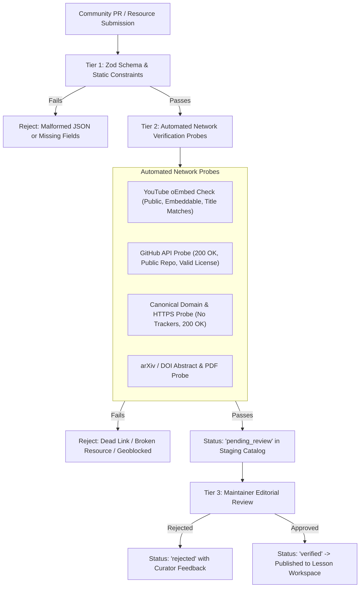

# Resource Discovery, Curation & Verification Specification
## AI Engineer OS — Curated Educational Knowledge Registry (Corrected)

---

### 1. Registry Architecture & Principles

AI Engineer OS maintains a curated registry of multimedia learning assets, research papers, repositories, and documentation.

#### Core Curation Principles
1. **Zero Fabrication**: No links, video IDs, channel names, repository stars, or timestamps may be invented or generated. If a verified resource does not exist for a lesson, the lesson is reported as uncurated rather than filled with placeholders.
2. **Attribution & Rights**: No third-party video or content is rehosted or downloaded. Videos use YouTube's permitted embed player with privacy-enhanced mode (`youtube-nocookie.com`).
3. **Mandatory Editorial Approval**: Community contributions are ingested with `editorial_review_status = 'pending_review'`. Automated CI checks validate syntax and link health, but **only designated human maintainers can grant `verified` status**. Only `verified` resources render by default in the Learner Workspace.

---

### 2. Supported Resource Types

| Type Identifier | Name | Canonical Format | Embedding / Display Strategy |
| :--- | :--- | :--- | :--- |
| `youtube_video` | YouTube Video | `https://www.youtube.com/watch?v={id}` | Privacy-enhanced iframe embed + direct watch link + chapter jumps |
| `youtube_playlist`| YouTube Playlist | `https://www.youtube.com/playlist?list={id}` | Embedded playlist player with sequential chapter tracker |
| `github_repo` | GitHub Repository | `https://github.com/{owner}/{repo}` | Rich repo card (description, license, primary language, verified link) |
| `official_doc` | Official Documentation | Canonical documentation URL | Direct external link card with provider badge (PyTorch, Hugging Face, etc.) |
| `written_tutorial`| Written Deep-Dive | Canonical article / blog URL | Author citation, publication date, reading time, summary card |
| `research_paper` | Research Paper | arXiv or official DOI link | Title, authors, abstract snippet, PDF link, BibTeX citation helper |
| `dataset` | Dataset | Hugging Face, Kaggle, or official host | Size, format, licensing, download / viewer link |
| `interactive_exercise`| Interactive Lab | Colab, Kaggle Notebook, or web lab | Pre-configured environment link with exercise instructions |
| `project_starter` | Project Template | GitHub starter template repository | Clone command, prerequisites, milestone checklist |

---

### 3. Multi-Tier Resource Verification Pipeline



#### Detailed Verification Rules by Type:
1. **YouTube Videos (`youtube_video`, `youtube_playlist`)**:
   - **Tier 2: Automated oEmbed Check (Preliminary)**:
     - Queries YouTube's public oEmbed endpoint: `https://www.youtube.com/oembed?url=https://www.youtube.com/watch?v={video_id}&format=json`
     - Confirms video exists, is public, has embedding enabled by the creator, and matches author/title metadata without requiring private API keys.
     - **Important Limitation**: oEmbed is a **metadata and preliminary availability check only**. It does **NOT** guarantee worldwide playback, embedding in all regions, or absence of geoblocking. A video may pass oEmbed yet be unavailable in certain countries or regions.
   - **Optional Tier 2.5: YouTube Data API Verification (If API Key Configured)**:
     - If a YouTube Data API v3 key is available in environment variables, probe the `videos.list` endpoint with `part=contentDetails,status,snippet`.
     - Extract `regionRestriction` fields to identify blocked/allowed countries.
     - Check `status.privacyStatus` for unlisted or private states.
     - **Result States**:
       - `verified`: Global availability (no region restrictions), embedding allowed, public status.
       - `regional`: Available in specific regions only (requires manual maintainer decision for target audience).
       - `unknown`: API key not configured or quota exceeded (fall back to oEmbed + manual review).
       - `failed`: Video deleted, private, or embedding disabled.
   - **Fallback Strategy for Unknown/Failed States**:
     - Set resource `editorial_review_status = 'pending_review'`.
     - Maintainer manually tests direct playback in target regions.
     - If verification fails, maintainer marks as `rejected` or replaces with alternative resource.
   - **Direct Video Links as Fallback**:
     - If embedded playback is blocked but direct `youtube.com/watch?v={id}` link works, resource can be marked as `verified` with a `display_mode = 'external_link_only'` flag (rendering as external link card instead of embed player).
2. **GitHub Repositories (`github_repo`, `project_starter`)**:
   - Automated probe queries `https://api.github.com/repos/{owner}/{repo}` or performs an authenticated HTTP HEAD.
   - Verifies the repository is public, active, contains an open-source license, and specifies its default branch.
3. **Official Documentation (`official_doc`)**:
   - Must originate from canonical organizational domains (e.g. `docs.python.org`, `pytorch.org`, `huggingface.co`, `modelcontextprotocol.io`).
   - Must use HTTPS, strictly prohibit URL shorteners, and be free of affiliate tracking query parameters.
   - HTTP HEAD probe must return `200 OK` with `Content-Type: text/html`.
4. **Research Papers (`research_paper`)**:
   - Must point to official pre-print servers (`arxiv.org/abs/...`), open access journals, or verified DOIs.
   - Probes verify both abstract and PDF reachability.

---

### 4. Zod Resource Schema

All resource records must conform to the following schema (`src/lib/schemas/resource.ts`):

```typescript
import { z } from 'zod';

export const ResourceTypeSchema = z.enum([
  'youtube_video',
  'youtube_playlist',
  'github_repo',
  'official_doc',
  'written_tutorial',
  'research_paper',
  'dataset',
  'interactive_exercise',
  'project_starter',
]);

export const EditorialStatusSchema = z.enum([
  'verified',
  'pending_review',
  'rejected',
  'deprecated',
]);

export const ResourceItemSchema = z.object({
  id: z.string().regex(/^[a-z0-9-]+$/, 'ID must be kebab-case alphanumeric'),
  title: z.string().min(5).max(200),
  canonical_url: z.string().url('Must be a valid HTTP/HTTPS URL'),
  type: ResourceTypeSchema,
  author: z.object({
    name: z.string().min(2).max(100),
    channel_or_org: z.string().optional(),
    profile_url: z.string().url().optional(),
  }),
  associated_lesson_keys: z.array(z.string()).min(1, 'Must link to at least one canonical lesson key'),
  difficulty: z.enum(['beginner', 'intermediate', 'advanced', 'all_levels']),
  language: z.string().default('en'),
  estimated_duration_minutes: z.number().int().positive().optional(),
  description: z.string().min(10).max(500),
  prerequisites: z.array(z.string()).default([]),
  license: z.string().optional(),
  editorial_review_status: EditorialStatusSchema.default('pending_review'),
  editorial_notes: z.string().optional(),
  last_verified_at: z.string().datetime(),
  youtube_metadata: z.object({
    video_id: z.string().regex(/^[a-zA-Z0-9_-]{11}$/),
    start_seconds: z.number().int().nonnegative().optional(),
    end_seconds: z.number().int().positive().optional(),
    chapters: z.array(z.object({
      timestamp_seconds: z.number().int().nonnegative(),
      title: z.string(),
    })).optional(),
  }).optional(),
  github_metadata: z.object({
    owner: z.string(),
    repo: z.string(),
    default_branch: z.string().default('main'),
    subpath: z.string().optional(),
  }).optional(),
});
```

---

### 5. Link Integrity & Coverage Auditing

AI Engineer OS **will include** a built-in verification suite to be implemented in Phase 3:
`npm run resources:audit`

The audit tool checks:
1. **Schema Conformance**: Validates all JSON files in `resources/` against `ResourceItemSchema`.
2. **Foreign Key Integrity**: Confirms every `associated_lesson_keys` matches an existing lesson `content_hash` or `current_slug` in `canonical_lessons`.
3. **Automated oEmbed & HTTP Health Checks**: Probes HTTP endpoints to catch link rot before it reaches learners.
4. **Coverage Matrix Generation**: Generates `docs/RESOURCE_COVERAGE_REPORT.md` detailing:
   - Total curriculum lessons.
   - Lessons with >= 1 verified video.
   - Lessons with official documentation links.
   - Uncurated lessons requiring community contributions.

---

### 6. Contributor Workflow for Adding Resources

1. Fork the repository and create a branch `feature/curate-{topic}`.
2. Add a new JSON file under `resources/catalog/{phase-slug}/{resource-id}.json` with `editorial_review_status: "pending_review"`.
3. Run `npm run resources:validate` to ensure schema validation passes.
4. Run `npm run resources:test-links` to ensure URLs pass automated network probes.
5. Submit a pull request. A repository maintainer will review pedagogical relevance and quality before merging and promoting to `"verified"`.
